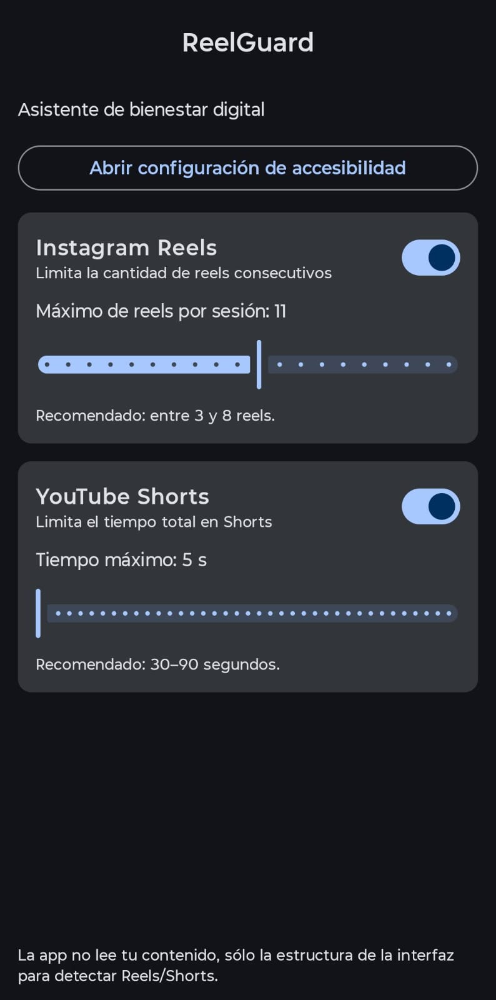

# ReelGuard: Tu Asistente de Bienestar Digital

ReelGuard es una aplicación de Android que te ayuda a tomar el control de tu consumo de videos cortos en **Instagram Reels**, **YouTube Shorts** y **TikTok**. Utiliza un Servicio de Accesibilidad de Android para detectar tu actividad de forma local y segura, sin recolectar ningún tipo de dato personal.

---

## 🌟 Características Principales

- **Límite de videos seguidos:** máximo de Reels, Shorts y TikToks consecutivos. Al llegar, aparece una **pantalla de bloqueo con cuenta regresiva** (de 5 segundos a 10 minutos).
- **Bloquear o no los botones del sistema:** con la opción activada no se puede salir hasta que termine la cuenta regresiva. Desactivada, la pantalla de bloqueo no tapa Inicio / Volver / Recientes y desaparece al salir de la app.
- **Límite diario por app:** total de Reels, Shorts o TikToks por día. Al llegar, no se puede entrar a la sección de videos hasta las 00:00.
- **Horario sin videos:** por ejemplo de 23:00 a 07:00 (puede cruzar la medianoche). Solo se bloquea la sección de videos; mensajes, feed, perfil, etc. se usan normal.
- **Estadísticas:** videos vistos y bloqueos de hoy (comparado con tu promedio) y gráfico de barras de los últimos 7 días por app.
- **Estado de permisos:** la pantalla principal muestra si el servicio de accesibilidad y el permiso de superposición están activos.
- **YouTube Shorts en ventana flotante:** si un Short se minimiza al tocar Inicio, la ventana se cierra.
- **Los comentarios no reinician el contador** (Instagram y TikTok).
- **Privacidad primero:** todo funciona en el dispositivo. No requiere internet y no envía información.

> El límite diario y el horario sin videos **no** muestran la pantalla de bloqueo: si entrás a la sección de videos, ReelGuard te saca (Volver, o la pestaña Perfil en TikTok) y muestra un aviso. El resto de la app sigue disponible.

---

## 📸 Captura de Pantalla de la aplicación



---

## ⚠️ Una Nota Importante Sobre la Fiabilidad

La aplicación funciona analizando la estructura de la interfaz de usuario (UI) de Instagram, YouTube y TikTok. **No utiliza ninguna API oficial**, ya que no existen para esta finalidad.

Esto significa que su funcionamiento es **frágil por naturaleza**. Si alguna de estas apps cambia su diseño, es probable que la detección deje de funcionar hasta que se actualicen las heurísticas. Cada heurística está documentada en su módulo:

| App | Módulo | Cómo detecta |
| --- | --- | --- |
| Instagram | `InstagramModule` | Scroll de un `ViewPager` + nodos con descripción "Reel de …" |
| YouTube | `YoutubeShortsModule` | "Progreso del video" / `SeekBar` + carrusel a pantalla completa; cuenta por scroll o por cambio de duración del video ([logcat de referencia](./docs/logcat_youtube.txt)) ([captura de referencia](./docs/youtube_shorts.jpeg)); ventana flotante vía lista de ventanas |
| TikTok | `TikTokModule` | Pestaña "Para ti" (visible) + scroll de un contenedor a pantalla completa ([captura de referencia](./docs/tiktok_feed.jpeg)) |

Para depurar, filtrar Logcat por `ReelGuard-Instagram`, `ReelGuard-TikTok` o `ReelGuard-YouTube`.

---

## 🛠️ Tecnologías y Arquitectura

- **Lenguaje:** [Kotlin](https://kotlinlang.org/) (100%)
- **UI:** [Jetpack Compose](https://developer.android.com/jetpack/compose) + Material 3.
- **Arquitectura:** MVVM (Model-View-ViewModel).
- **Gestión de Estado:** Kotlin Flows y StateFlow.
- **Persistencia:** [Jetpack DataStore](https://developer.android.com/topic/libraries/architecture/datastore) (Preferences) para la configuración, los bloqueos y las estadísticas.
- **Servicio de Accesibilidad único** (`ReelGuardService`) que reparte los eventos a un módulo por app (`BlockerModule`). Lo común (pantalla de bloqueo, horarios, límites diarios, estadísticas) vive en el servicio; lo específico de cada app, en su módulo.

```
feature/service/
├── ReelGuardService.kt        ← servicio único (bloqueos, horarios, estadísticas)
├── BlockerModule.kt           ← interfaz de cada app
└── modules/
    ├── InstagramModule.kt
    ├── YoutubeShortsModule.kt
    └── TikTokModule.kt
```

---

## 🚀 Cómo Empezar

1.  **Clona el repositorio:**
    ```bash
    git clone https://github.com/TomasSantillanUTN/ReelGuard.git
    ```
2.  **Abre el proyecto** en Android Studio.
3.  **Sincroniza Gradle** y espera a que se descarguen las dependencias.
4.  **Ejecuta la aplicación** en un emulador o en un dispositivo físico.
5.  **Activa los permisos** desde la tarjeta "Estado" de la pantalla principal:
    - **Servicio de accesibilidad "ReelGuard"** (uno solo para las tres apps). En algunos celulares está dentro de "Apps instaladas" o "Servicios descargados".
    - **Mostrar sobre otras apps** (para la pantalla de bloqueo).

> Si venías de una versión anterior con tres servicios separados, desactivalos: ahora hay un único servicio "ReelGuard".

---

*Este proyecto fue creado como parte de mi portfolio personal. ¡Espero que te guste!*
